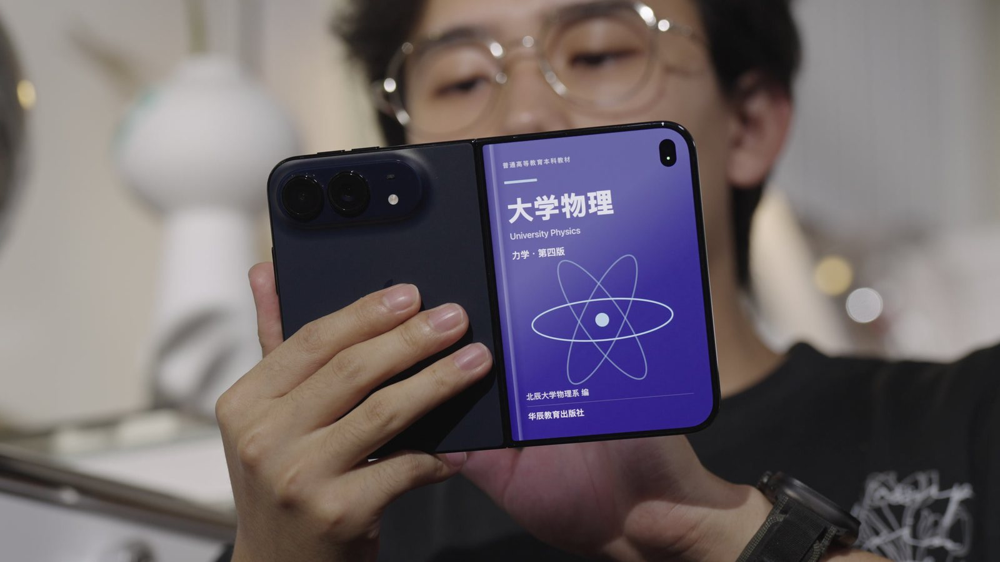
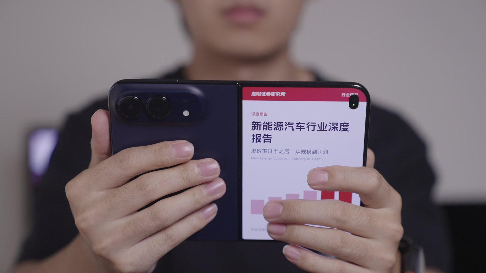
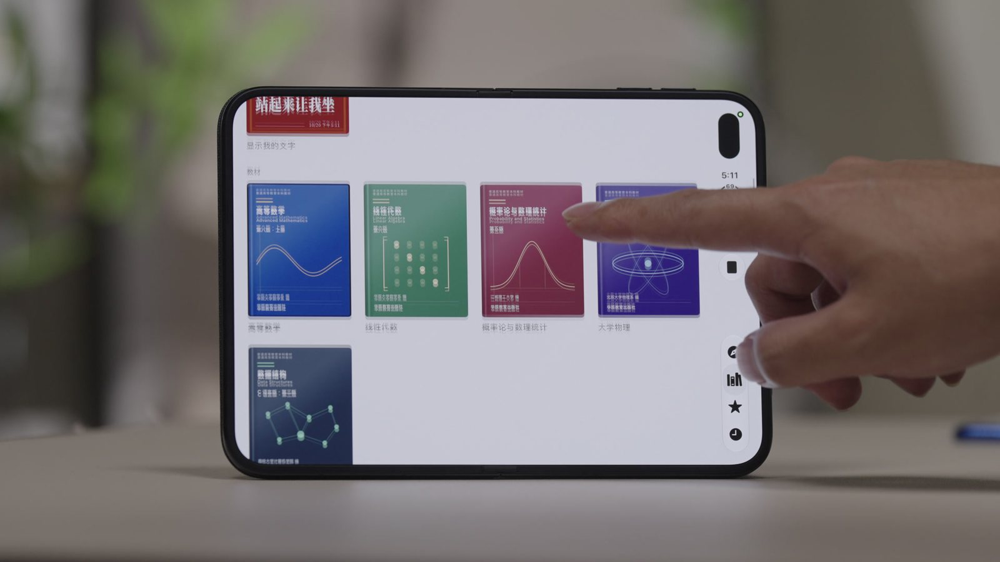

<p align="center">
  
</p>

<h1 align="center">光谱Spec · 摸鱼浏览器</h1>

<p align="center">
  <b>Decoy Screen</b> — 内屏上网，外屏冲着同事放一本《高等数学》。
</p>

<p align="center">
  
  
  
  
</p>

<p align="center">
  
  
</p>
<p align="center">
  
</p>

> 这是光谱Spec 为 iPhone Duo 做的三个「最没用、但非常适合 iPhone Duo」的 App 之一，另外两个是
> [广东模拟器](https://github.com/Xenogeneic112/GuangpuSpec-FoldSmash) 和 [工位指示牌](https://github.com/Xenogeneic112/GuangpuSpec-DeskSign)。

## 它是怎么摸鱼的

iPhone Duo 半开拿在手里时，内屏朝着你，外屏朝着对面的人。摸鱼浏览器利用的就是这一点：

| 你在做什么 | 内屏（你看到的） | 外屏（别人看到的） |
| --- | --- | --- |
| 展开手机正常使用 | 一个完整的浏览器 | 你选好的书或研报封面 |
| 有人走过来，点工具栏的「封面」 | 立刻换成这本书的内页，正经地翻 | 还是那本书 |
| 合上手机 / 立成帐篷 | — | 封面铺满外屏，正在播放的视频自动暂停 |

### 浏览器

内屏是一个仿 Chrome 风格的完整浏览器（基于 WebKit，Apple 只允许 App 内嵌 Safari 引擎）：多标签页与标签总览、无痕标签、书签、历史记录、地址栏搜索建议、可选搜索引擎，默认请求 iPad 桌面版网页，和 iPad 上的 Safari / Chrome 一样。

### 伪装书架

外屏显示什么由你在「封面」页里挑选，共 4 个书架、20 本：

- **教材**：高等数学、线性代数、概率论与数理统计、大学物理、数据结构
- **专业书**：机器学习导论、公司金融、宏观经济学、民法总论
- **人文社科**：从篝火到城市、小团队大航程、夜间修复、慢慢变富的常识、纯粹理性批判、未来形而上学导论
- **研报财报**：新能源汽车行业深度报告、半导体设备 2027 年度策略、2025 年年度报告、2026 年第三季度业绩报告、宏观经济月报

每本书都有自己的封面（教材、专业书、券商研报、财报、畅销书、经典丛书 6 种版式）和可以翻阅的内页，书会记住你上次翻到哪一页。书名、作者、出版社和机构都是虚构的；康德的两部著作属于公有领域，封面是原创设计，正文是我们自己的译文。

### 自定义外屏文字

也可以不放书，直接在外屏写一句话（比如「会议中」），有 5 种样式：标题卡、白昼、警报、紧急、监视——粗宋体、窄字距、细线与小标签，像电影的标题卡。

## 关于相机权限

iOS 只允许 App 在**内屏正在使用**时往外屏放自己的内容，前提是 App 有一个正在运行的相机会话（这正是 `CameraCaptureAccessory` 的用途）。所以摸鱼浏览器会请求相机权限，并只维持最小的会话：后置相机、最低画质与帧率、帧直接丢弃，**不录制、不保存任何内容**。运行期间相机指示灯会亮着。

不授权相机也能用：合上手机时外屏照样显示封面，只是展开使用时外屏不会同时显示。

## 运行要求

- **Xcode 27.1**（iOS 27.1 SDK）。
- **iPhone Duo** 真机，或 Xcode Device Hub 里的 iPhone Duo 模拟器。模拟器没有相机，所以「展开时外屏同时显示」只能在真机上看到，合上手机就能在模拟器里看到外屏封面。

## 开始使用

```bash
git clone https://github.com/Xenogeneic112/GuangpuSpec-DecoyScreen.git
cd GuangpuSpec-DecoyScreen
open DecoyScreen.xcodeproj
```

1. 选择 scheme **DecoyScreen 中文**，运行目标选 iPhone Duo。
2. 真机运行前，在 **Signing & Capabilities** 里选择你自己的 Team，并把 Bundle Identifier（默认 `com.example.duovibes.decoyscreen`）改成你自己的。
3. 按 ⌘R。第一次展开使用时允许相机权限。

## 项目结构

```
GuangpuSpec-DecoyScreen/
├── DecoyScreen.xcodeproj
├── DecoyScreen/
│   ├── RootView.swift        内外屏的切换逻辑：内屏浏览器 / 外屏封面
│   ├── CameraKeeper.swift    维持外屏显示所需的最小相机会话
│   ├── Browser/              浏览器：标签页、历史、书签、设置（WebKit）
│   ├── BookCatalog.swift     20 本书的元数据与内页文字
│   ├── BookCover.swift       6 种封面版式与封面图案，全部代码绘制
│   ├── BookReader.swift      内页阅读器
│   ├── ShelfPicker.swift     书架与自定义文字编辑
│   ├── Decoy.swift           当前选择的保存、外屏文字样式
│   └── Fonts/                思源宋体 Heavy（Noto Serif SC，SIL OFL 1.1）
└── DuoKit/                   铰链层 Swift Package（三个 App 共用）
```

## DuoKit：铰链层

三个 App 共用的小型 Swift Package，把 iPhone Duo 的铰链 API 包成 SwiftUI 友好的接口：`HingeMonitor` 给出当前姿态（合拢 / 帐篷 / 书本 / 展平）、角度和开合速度。唯一直接调用 Apple 新 API 的文件是 `DuoKit/Sources/DuoKit/LiveHingeReader.swift`。测试：`cd DuoKit && swift test`。

## English

**Decoy Screen** is a full browser on the iPhone Duo's inner screen while the outer screen — the one facing your coworkers — shows the cover of a calculus textbook, a broker research report or one of 20 books on four shelves (all titles invented, except two public-domain Kant works). Tap **Cover** and the inner screen instantly switches to that book's pages. You can also put your own line of text outside in five title-card styles. iOS only lets an app draw on the outer screen while the inner one is in use if a camera session is running, so the app keeps the smallest possible one: nothing is recorded or saved. Requires Xcode 27.1 and an iPhone Duo or its simulator.

## 许可与致谢

- 代码：[MIT](LICENSE) © 2026 光谱Spec
- 字体：Noto Serif SC（思源宋体），SIL Open Font License 1.1，见 `DecoyScreen/Fonts/NotoSerifSC-OFL.txt`
